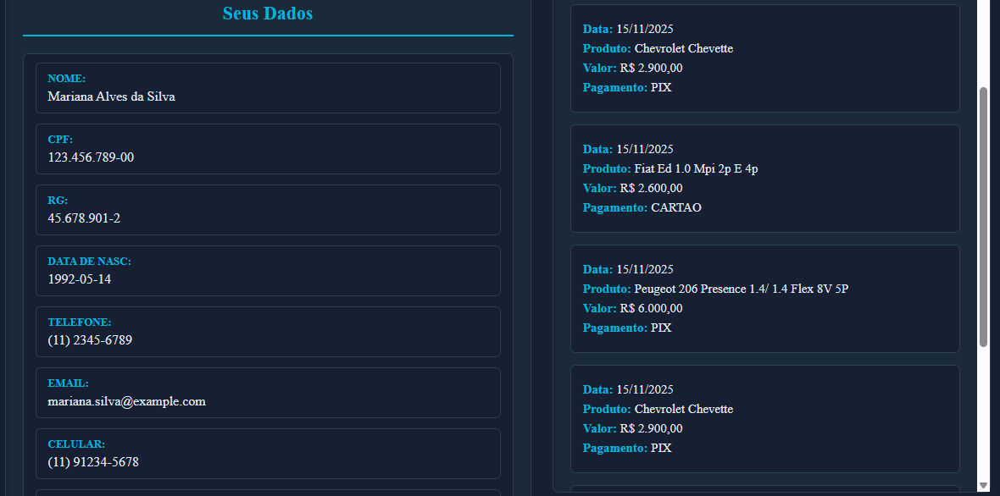
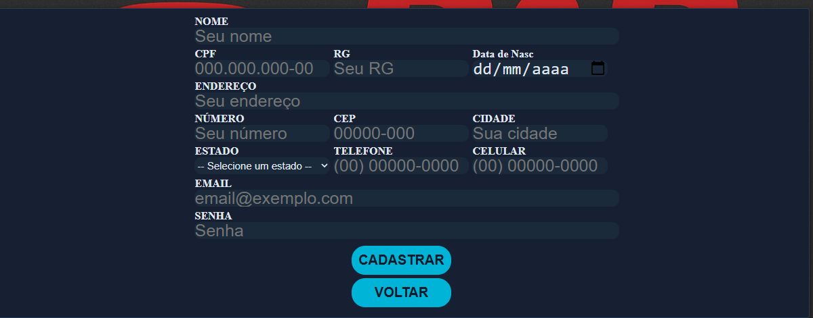

# 🚗 R&R Veículos

> Plataforma web de compra e venda de veículos usados, desenvolvida com PHP, JavaScript e JSON como banco de dados.

---

## 📋 Sobre o Projeto

O **R&R Veículos** é uma aplicação web full-stack que simula um sistema funcional de revenda de automóveis. O projeto conta com catálogo de veículos, autenticação de usuários, páginas de detalhes por produto e fluxo completo de compra, do carrinho à confirmação.

> **Destaques técnicos:** arquitetura cliente-servidor com PHP puro, comunicação assíncrona via `fetch()`, autenticação com sessões PHP e persistência em arquivos JSON — sem frameworks e sem banco de dados externo.

---

## 🛠️ Tecnologias Utilizadas

| Camada | Tecnologias |
|--------|------------|
| **Frontend** | HTML5 semântico, CSS3, JavaScript (ES6+) |
| **Backend** | PHP 8+ |
| **Dados** | JSON (arquivos estruturados) |
| **Autenticação** | PHP Sessions + `password_hash` / `password_verify` |
| **Comunicação** | `fetch()` API (cliente → servidor) |

---

## 📁 Estrutura do Projeto

```
Trabalho_DW/
├── index.php                  # Página inicial com catálogo
├── .gitignore
├── README.md
│
├── data/
│   ├── catalogo.json          # Catálogo de veículos
│   ├── vendas.json            # Histórico de vendas
│   └── img/                   # Imagens (banners, veículos, perfis)
│
├── html/
│   ├── estilos.css            # Estilos globais
│   ├── script.js              # Banner rotativo e interações gerais
│   ├── carrega_produtos_api.js # Carrega catálogo via API + paginação
│   ├── detalhes.js            # Popula página de detalhes do veículo
│   ├── compra.js              # Popula página de checkout
│   ├── login.php              # Autenticação de usuários
│   ├── logout.php             # Encerramento de sessão
│   ├── cadastro.php           # Cadastro de novos usuários
│   ├── perfil.php             # Perfil + histórico de compras
│   ├── detalhes.php           # Detalhes do veículo selecionado
│   ├── compra.php             # Tela de checkout
│   └── vendas.php             # Processamento e registro da venda
│
└── php/
    └── api_le_catalogo.php    # API REST simples — serve o catálogo JSON
```

---

## ✨ Funcionalidades

- [x] **Catálogo de veículos** com paginação (6 por página)
- [x] **Página de detalhes** com fotos, especificações e descrição
- [x] **Cadastro de usuário** com validação de campos
- [x] **Login / Logout** com sessões PHP e senhas com hash seguro
- [x] **Perfil do usuário** com dados pessoais e histórico de compras
- [x] **Fluxo de compra** com seleção de método de pagamento
- [x] **Banner rotativo** com transição automática de imagens
- [x] **Comunicação assíncrona** via `fetch()` entre frontend e API PHP
- [x] **Proteção de rotas** — páginas restritas redirecionam para login

---

## 🚀 Como Rodar Localmente

### Pré-requisitos

- [XAMPP](https://www.apachefriends.org/) ou [Laragon](https://laragon.org/) (PHP + Apache)
- Nenhuma dependência externa necessária

### Passo a passo

```bash
# 1. Clone o repositório
git clone https://github.com/seu-usuario/Trabalho_DW.git

# 2. Mova para a pasta do servidor
# XAMPP: C:\xampp\htdocs\Trabalho_DW
# Laragon: C:\laragon\www\Trabalho_DW

# 3. Inicie o Apache pelo painel do XAMPP / Laragon

# 4. Acesse no navegador
http://localhost/Trabalho_DW/
```

---

## 🔐 Usuários de Teste

> **Atenção:** Não commite o `usuarios.json` real. Crie usuários pelo cadastro da aplicação.

Para criar um usuário de teste, acesse `http://localhost/Trabalho_DW/html/cadastro.php` e preencha o formulário.

---

## 🗺️ Próximos Passos

- [ ] Integração com API de CEP (ViaCEP) no cadastro
- [ ] Validação de CPF com dígito verificador
- [ ] Filtro e busca de veículos por marca, preço e ano
- [ ] Painel administrativo para gerenciar o catálogo
- [ ] Migração para MySQL (via PDO)
- [ ] Containerização com Docker

---

## 🔄 CI/CD

> *Em desenvolvimento* — a integração contínua será configurada com **GitHub Actions** para validar sintaxe PHP e lint do JavaScript a cada push.

Exemplo de workflow planejado:

```yaml
# .github/workflows/ci.yml
name: CI

on: [push, pull_request]

jobs:
  lint-php:
    runs-on: ubuntu-latest
    steps:
      - uses: actions/checkout@v3
      - name: Lint PHP
        run: find . -name "*.php" -exec php -l {} \;
```

---

## 📸 Screenshots




---

## 📄 Licença

Este projeto está sob a licença MIT. Veja o arquivo [LICENSE](LICENSE) para mais detalhes.

---

<div align="center">
  Desenvolvido por <strong>Rodrigo Cesar</strong>
</div>
