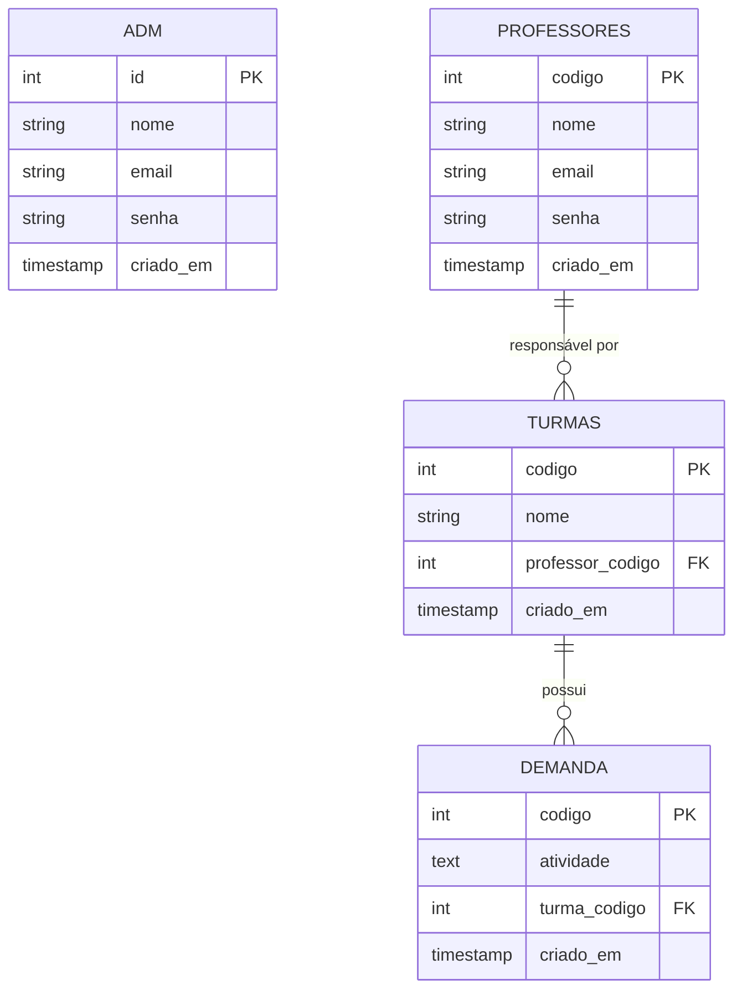

# 🎓 Sistema Web de Gestão Acadêmica EAD

> Plataforma full-stack em PHP e MySQL desenvolvida para centralização, controle de turmas e gerenciamento de demandas pedagógicas no ensino a distância.

---

## 📌 Sobre o Projeto

O **Sistema EAD** é uma solução web desenvolvida para resolver os desafios de desorganização operacional em instituições de ensino, centralizando o controle de professores, turmas e atividades acadêmicas em uma interface limpa, intuitiva e segura.

A aplicação conta com controle de acesso em dois níveis (Administrador e Professor), controle de sessão e regras rígidas de integridade referencial para impedir perda de dados pedagógicos.

---

## 🛠️ Tecnologias Utilizadas

| Camada | Tecnologias |
|---|---|
| **Backend** | PHP 8.x (MySQLi orientado a objetos com *Prepared Statements*) |
| **Banco de Dados** | MySQL / MariaDB (com chaves estrangeiras e integridade referencial) |
| **Frontend** | HTML5 semântico, CSS3, Bootstrap 5.3, Bootstrap Icons |
| **Autenticação** | Sessões nativas do PHP (`$_SESSION`) com isolamento por perfil |

---

## ⚙️ Regras de Negócio e Segurança

- 🔒 **Controle de Acesso Diferenciado**:
  - **Portal Administrativo**: Responsável pela gestão dos docentes (cadastro, pesquisa com filtro por nome e exclusão controlada).
  - **Portal do Professor**: Acesso individualizado onde cada docente visualiza e gerencia exclusivamente suas próprias turmas e atividades.
- 🛡️ **Integridade e Bloqueio de Exclusões**:
  - Uma turma **não pode ser removida** caso ainda possua atividades associadas.
  - Um professor **não pode ser removido** se ainda possuir turmas sob sua responsabilidade.
- 💉 **Prevenção de SQL Injection**: Consultas sensíveis e formulários utilizam consultas parametrizadas com Prepared Statements.

---

## 🗄️ Modelo do Banco de Dados



---

## 🚀 Como Executar o Projeto Localmente

### Pré-requisitos
- Servidor local PHP com MySQL: [XAMPP](https://www.apachefriends.org/) ou [Laragon](https://laragon.org/)
- Navegador web moderno

### Passo a passo

1. **Clonar ou posicionar a pasta do projeto**:
   Coloque a pasta `Sistema_cadastro` dentro do diretório raiz do seu servidor web:
   - **XAMPP**: `C:\xampp\htdocs\Sistema_cadastro`
   - **Laragon**: `C:\laragon\www\Sistema_cadastro`

2. **Criar e importar o Banco de Dados**:
   - Abra o **phpMyAdmin** (`http://localhost/phpmyadmin`) ou seu cliente SQL favorito.
   - Execute o script disponível em [`database/schema.sql`](database/schema.sql).
   - O script criará o banco `sistema_ead` com todas as tabelas e usuários de demonstração.

3. **Verificar a conexão**:
   - Caso necessário, ajuste os parâmetros de conexão no arquivo [`config.php`](config.php):
     ```php
     $host     = 'localhost';
     $usuario  = 'root';
     $senha    = '';
     $banco    = 'sistema_ead';
     ```

4. **Acessar a Aplicação**:
   - Acesse no navegador: `http://localhost/Sistema_cadastro/`

---

## 🔑 Credenciais Padrão para Testes

O script de inicialização do banco já disponibiliza os seguintes usuários pré-cadastrados:

| Perfil | E-mail | Senha | URL de Entrada |
|---|---|---|---|
| **Administrador** | `admin@ead.com` | `admin123` | `http://localhost/Sistema_cadastro/admin_tela.php` |
| **Professor** | `professor@ead.com` | `prof123` | `http://localhost/Sistema_cadastro/index.php` |

---

## 🔄 Pipeline de CI/CD (GitHub Actions)

O projeto está preparado para integração contínua. Para validar a sintaxe dos scripts PHP a cada push ou pull request, crie o arquivo `.github/workflows/ci.yml`:

```yaml
name: CI - Verificação de Sintaxe PHP

on:
  push:
    branches: [ "main", "master" ]
  pull_request:
    branches: [ "main", "master" ]

jobs:
  lint:
    runs-on: ubuntu-latest
    steps:
      - name: Checkout do código
        uses: actions/checkout@v4

      - name: Configurar PHP
        uses: shivammathur/setup-php@v2
        with:
          php-version: '8.2'

      - name: Testar sintaxe de todos os arquivos PHP
        run: |
          find . -name "*.php" -exec php -l {} \;
```

---

## 📁 Estrutura de Arquivos

```
Sistema_cadastro/
├── config.php                  # Conexão central com o banco de dados
├── database/
│   └── schema.sql              # Script DDL com estrutura e seeders
├── index.php                   # Portal de login dos professores
├── login.php                   # Processamento de autenticação docente
├── admin_tela.php              # Portal de login do administrador
├── login_adm.php               # Processamento de autenticação administrativa
├── listar_turmas.php           # Painel de turmas do professor logado
├── cadastrar_turma.php         # Cadastro de novas turmas vinculadas ao professor
├── deletar_turma.php           # Exclusão com validação de dependências
├── listar_demandas.php         # Listagem de atividades pedagógicas por turma
├── cadastrar_atividade.php     # Cadastro de novas atividades para a turma
├── listar_professor.php        # Painel administrativo com listagem de docentes
├── cadastrar_professor.php     # Cadastro de novos professores pelo admin
├── pesquisar_professor.php     # Busca dinâmica de professores por nome
├── deletar_professor.php       # Exclusão com validação de turmas vinculadas
├── erro.php                    # Notificação amigável de bloqueio de exclusão de turma
├── erro_prof.php               # Notificação amigável de bloqueio de exclusão de docente
├── sucesso.php                 # Confirmação de operações do professor
├── sucesso_prof.php            # Confirmação de operações do administrador
├── logout.php / logout_adm.php # Destruição segura de sessões
├── .gitignore
└── README.md
```

---

## 📄 Licença

Este projeto está sob licença **MIT**. Sinta-se livre para utilizar e aprimorar.

<div align="center">
  Desenvolvido por <strong>Rodrigo</strong>
</div>
